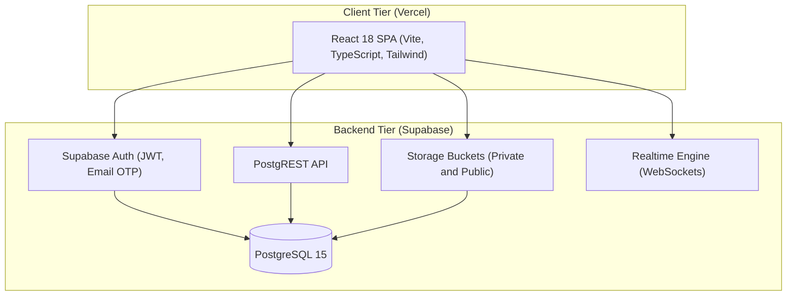
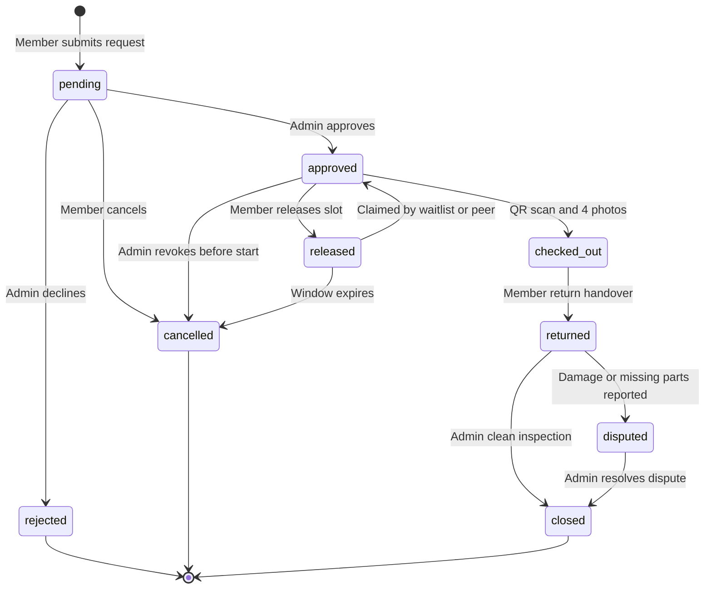

# EquipSync

An institutional equipment and space sharing platform with cryptographic handover verification, multi-tenant isolation, and automated domain approval (formerly CampusShare).

Live deployment: [https://equip-sync-ashy.vercel.app](https://equip-sync-ashy.vercel.app) [FILL: confirm live URL]  
Built for the CodeVerse India 2026 Hackathon (WeCodeCoders), addressing the problem statement "Unlock Underused Equipment and Spaces".

## The problem and why we built it this way

Shared equipment in university departments, makerspaces, and research institutes suffers from a trust deficit. High-value gear like laser cutters, cinema cameras, spectrometers, and cleanrooms often sits idle behind locked doors because lab managers worry about unaccounted damage, missing accessories, or unauthorized use. When borrowing happens informally or via shared spreadsheet calendars, there is no verifiable paper trail.

Standard calendar tools show time availability, but they cannot verify whether a borrower holds safety induction credentials, whether accessories were returned, or what physical state the asset was in when handed over. When an optical nozzle breaks or a lens gets scratched, disputes arise because nobody can prove who held custody when the fault occurred.

We built EquipSync to replace honor-system checkouts with an audit-first lending engine. Two people cannot book the same slot: PostgreSQL GiST exclusion constraints reject overlapping reservations directly at the database level. Handover requires physical presence via QR scanning, an accessory checklist, and four-angle photo evidence hashed with browser-side SHA-256 signatures before upload. The result is a verifiable chain of custody where liability is clear and gear stays in service.

## How a loan works

1. Organization setup: An administrator registers their organization with verified web and contact details. When the admin's email domain matches the official website host, the organization receives a Verified Domain trust badge.
2. Member induction: Students, researchers, and staff sign up. Email addresses matching verified organizational domains are auto-approved without manual queues. Members upload or complete safety qualifications (such as laser safety or cleanroom induction) required for specific equipment tiers.
3. Discovery and reservation: Members browse active gear and submit a reservation with a stated purpose and supervisor name. If the resource requires administrative review, it enters the Request Queue; otherwise, eligible requests with no conflicts approve immediately.
4. Administrative review: For high-tier equipment, administrators review incoming requests at `/app/institution/requests`. Built-in overlap detection flags conflicting bookings, allowing admins to approve with safety instructions or decline with an explanatory note.
5. Physical handover gate: The check-out window opens 15 minutes before the booking starts. Hardware check-out is locked until approved. The borrower scans the equipment's physical QR tag (`EQS-...`), completes the accessory checklist, and captures four required photo angles (`front`, `back`, `left`, `right`) with browser-calculated SHA-256 hashes.
6. Active custody: The borrower holds verified custody. When returning the gear, the borrower generates a return passcode, re-scans the asset QR tag, records component condition, and captures return photos.
7. Inspection and closure: An administrator inspects the return against the check-out photo baseline. A clean inspection closes the booking. Damaged components or missing accessories automatically open an incident report and transition the record into a formal dispute for resolution.

## What is in it

### Organizations and members
The platform is organized around strict organizational boundaries. Administrators onboard via a three-step wizard with live name uniqueness checking. Members verify automatically through institutional email domains, while guest or external affiliate accounts enter an administrative vetting queue.

### Reservations and fairness
Reservations use pessimistic database locking and range exclusion constraints to eliminate double bookings. If a member finishes early or cancels an approved reservation, the released slot is immediately offered to waitlisted members in first-in, first-out order.

### Chain of custody
Every physical handover produces tamper-evident photo records and event logs. Borrowers can inspect prior return photos to confirm incoming equipment condition, but prior borrower names, notes, and accessory details are redacted at the database level to protect user privacy.

### Administrative workbench
The administrative portal includes a Request Queue with conflict collision detection, fleet utilization reporting over 30-day windows, an immutable audit log, and a dispute resolution interface for handling damaged returns.

### Authentication and access control
Authentication runs on Supabase Auth supporting six-digit email one-time passcodes (OTP), secure password recovery with attempt throttling, custom transactional SMTP delivery, and role-scoped JWT tokens.

## How it fits together





## Security model

All authorization decisions run inside PostgreSQL `SECURITY DEFINER` functions with `set search_path = ''`. The browser client only mirrors what the database enforces.

- Walled-garden multi-tenancy: Every table, view, and storage path scopes access through `public.current_institution_id()`. A member or administrator from Organization A receives zero rows when attempting to query or deep-link into Organization B assets, bookings, or audit records.
- Revoked client writes: Direct client `INSERT`, `UPDATE`, and `DELETE` permissions are revoked on all critical state tables (`bookings`, `waitlist_entries`, `released_slots`, `custody_events`, `custody_photos`, `asset_audits`, `incidents`, `audit_log`). State transitions happen exclusively through hardened database RPCs.
- Defensive insert guards: Client-writable tables (`resources`, `qualifications`, `user_qualifications`, `resource_categories`) enforce `WITH CHECK` clauses matching `institution_id = current_institution_id()`.
- Anonymous access boundary: Unauthenticated callers can reach only four public endpoints: `search_institutions`, `match_organization_by_email`, `organization_name_available`, and aggregated count statistics. Direct table reads return zero rows.
- Domain auto-verification safeguards: Organization email domains are normalized, stripped of protocol/path/port prefixes, validated against strict regex syntax, and screened against a blocklist of consumer mail providers (`gmail.com`, `yahoo.com`, `outlook.com`, and similar). Wildcard domains (`*.domain.edu`) match subdomains without capturing bare domains or suffix traps.
- Immutable evidence storage: Storage buckets `custody-photos` and `asset-audit-photos` define insert and select policies scoped by tenant and booking participant, but define no update or delete policies. Evidence photos cannot be replaced or removed once uploaded.

## Tech stack

| Layer | Technology | Version | Purpose |
| :--- | :--- | :--- | :--- |
| **Frontend Framework** | React | 18.3.1 | Single-page application UI |
| **Language** | TypeScript | 5.6.3 | Type safety across client and database contracts |
| **Build Tool** | Vite | 5.4.11 | Development server and production bundling |
| **Styling** | Tailwind CSS | 3.4.15 | Responsive styling with CSS custom property theming |
| **Component Primitives**| Radix UI / shadcn/ui | Various | Accessible dialogs, tabs, popovers, and sheets |
| **Client State** | TanStack Query | 5.105.0 | Server state synchronization and query caching |
| **Backend & Database** | Supabase / PostgreSQL | 15.0 | Relational database, Auth, Storage, and Realtime |
| **Database Extensions** | btree_gist, pgcrypto | Postgres 15 | Range exclusion constraints and cryptographic hashes |
| **Testing** | Playwright & Axe-Core | 1.64.1 / 4.14.0| Browser integration and WCAG 2.1 AA accessibility tests |

## Getting started

### Prerequisites
- Node.js 18 or newer (tested on Node 22 and 24).
- A Supabase project running PostgreSQL 15 with `btree_gist` and `pgcrypto` extensions enabled.

### 1. Clone and install
Clone the repository and install dependencies:

```powershell
git clone https://github.com/tanishqrana775/EquipSync.git CampusShare
cd CampusShare
npm install
```

### 2. Configure environment variables
Copy the example environment file and add your Supabase credentials:

```powershell
Copy-Item .env.example .env.local
```

Set the following variable names in `.env.local`:
- `VITE_SUPABASE_URL`: Your Supabase project URL.
- `VITE_SUPABASE_ANON_KEY`: Your Supabase public anonymous key.

### 3. Apply database migrations
Execute the SQL migrations in `supabase/migrations/` in numerical order via the Supabase Dashboard SQL Editor:

1. `0001_schema.sql` (Tables, enums, indexes, constraints)
2. `0002_functions.sql` (Core RPCs, helpers, triggers)
3. `0003_rls_storage.sql` (Initial RLS policies and storage buckets)
4. `0004_fixes.sql` (Profile triggers and performance indexes)
5. `0005_multitenant.sql` (Tenant-scoped policies)
6. `0006_directory_search.sql` (Organization search function)
7. `0007_condition_enum.sql` (Condition rating enum alignment)
8. `0008_custody_v2.sql` (QR validation, checklists, and hash checks)
9. `0009_rpc_grants.sql` (RPC execution grants)
10. `0010_resources_hardening.sql` (Categories, asset tags, lifecycle states)
11. `0011_domain_verification.sql` (Domain auto-approval and normalization)
12. `0012_custody_hub.sql` (Spot audits, timeline redaction, custody summary)
13. `0013_enterprise_b2b_workflow.sql` (B2B onboarding, request queue, approval lock)

### 4. Supabase authentication and email setup
- In Supabase Dashboard -> **Authentication** -> **Providers** -> **Email**: Enable email signup and confirmation.
- Configure custom transactional SMTP credentials (detailed in `docs/SUPABASE_EMAIL_SETUP.md`) to avoid default rate-limit throttling.
- Set the OTP length to 6 digits and the expiry to 600 seconds.
- Copy email templates from `docs/email-templates/confirm-signup.html` and `docs/email-templates/reset-password.html` into the Supabase email template configuration.
- Set Redirect URLs to include your local origin (`http://localhost:3000/login?verified=1`) and production URL.

### 5. Run the local development server
```powershell
npm run dev
```

The application will start on `http://localhost:3000`.

### 6. Regenerate database types
To update TypeScript schema types after migration adjustments, use the Supabase CLI (requires a Supabase personal access token, which should never be committed):

```powershell
npx supabase gen types typescript --project-id <your-project-id> --schema public > src/lib/database.types.ts
```

## Running the tests

### End-to-end test suite (Playwright)
The integration suite tests authentication, landing page accessibility, sidebar navigation, inventory lifecycles, and the request approval queue against mock and live routes:

```powershell
npx playwright test
```

To run with a visible browser interface:

```powershell
npm run e2e:headed
```

### Automated API and security smoke test
`scripts/smoke-test.mjs` runs an automated integration suite directly against a Supabase instance using `@supabase/supabase-js`. It verifies public endpoint restrictions, domain validation rules, GiST overlap prevention (`slot_taken`), waitlist reallocation, photo upload integrity, and cross-tenant query isolation.

Because test accounts require immediate session tokens, the smoke test requires a staging instance with email confirmation disabled (or explicitly running with `SMOKE_ALLOW_PROD=true`):

```powershell
$env:SMOKE_ALLOW_PROD="true"
node scripts/smoke-test.mjs
```

### SQL isolation tests
The test scripts in `supabase/tests/` can be pasted directly into the Supabase Dashboard SQL Editor. Each script runs within an isolated transaction ending in `ROLLBACK;`, making them safe to run against any database without leaving leftover records:

- `supabase/tests/domain_verification_test.sql`: Tests domain normalization, wildcard subdomain matching, and consumer email provider blocking.
- `supabase/tests/rls_isolation_test.sql`: Seeds two distinct demo tenants, simulates cross-tenant JWT claims, and asserts zero-row visibility across all public tables.

## Project structure

```
CampusShare/
├── docs/                   # Engineering contracts, RLS matrix, demo script, email guides
│   ├── email-templates/    # Production HTML templates for signup and recovery OTP
│   ├── BACKEND_CONTRACT.md # Client-server RPC and error contract
│   ├── JUDGE_DEMO.md       # Step-by-step hackathon demonstration guide
│   ├── RLS_MATRIX.md       # Comprehensive permission and predicate reference
│   └── TERMINOLOGY.md      # Canonical glossary (organization vs code institution)
├── e2e/                    # Playwright test specifications and mock fixtures
├── scripts/                # Automated smoke test, concurrency check, and seed scripts
├── src/
│   ├── components/         # Reusable UI widgets, layout shells, and shared dialogs
│   │   ├── layout/         # AppSidebar, Topbar, ProtectedRoute, MobileBottomNav
│   │   ├── shared/         # StatusBadge, BookingLifecycle, OtpInput, ConditionMeter
│   │   └── ui/             # Radix UI and shadcn component primitives
│   ├── features/           # Domain-specific modules (custody timeline, auth wizards)
│   ├── hooks/              # TanStack Query data hooks (bookings, resources, custody)
│   ├── lib/                # Supabase client, auth helpers, RPC wrappers, error mappings
│   ├── pages/              # Primary route views (Dashboard, Discover, Requests, Custody)
│   └── providers/          # React context providers (AuthProvider, ThemeProvider)
└── supabase/
    ├── migrations/         # 13 ordered PostgreSQL schema and policy migrations
    └── tests/              # Transaction-safe SQL isolation test suites
```

## Things we learned the hard way

- Handover window boundaries: Early in testing, members arriving five minutes before their scheduled slot could not check out. We adjusted the check-out window constraint to `now() >= (start_at - interval '15 minutes') AND now() <= end_at`, giving borrowers a realistic grace period to inspect equipment before their loan starts.
- Email confirmation versus automated testing: Automated test suites need instant session tokens to test multi-role workflows. In production, Supabase requires email confirmation for security. Trying to use the same configuration broke automated runs, which led us to design `scripts/smoke-test.mjs` to target staging instances with confirmation disabled while keeping confirmation enabled in production.
- Default SMTP delivery limits: Supabase projects default to a shared SMTP server with strict rate limits (roughly three emails per hour). During team testing, signup verification codes quickly stalled. Switching to custom transactional SMTP and implementing clear resend cooldowns was necessary for reliable onboarding.
- WebRTC camera security: The camera QR scanner worked reliably in local development on `localhost`, but failed on mobile test devices until served over HTTPS. Modern browsers strictly block `navigator.mediaDevices.getUserMedia` on non-secure origins.
- Revoking direct client writes: Early iterations allowed direct table inserts with RLS checks. We realized this made atomic photo hash validation, pessimistic concurrency locks, and audit logging difficult to guarantee. Moving all mutations into `SECURITY DEFINER` RPCs created a single, hardened entry point for state changes.
- PostgreSQL GiST ranges over application checks: Trying to prevent double bookings by querying existing rows from client code left race conditions open. Enforcing an `EXCLUDE USING gist` constraint on `tstzrange(start_at, end_at, '[)')` pushed collision rejection into the database kernel, guaranteeing slot uniqueness even during concurrent requests.
- Multi-loan timeline privacy: Borrowers need to see the condition proof from the prior return so they aren't blamed for pre-existing wear. However, showing the prior loan exposed the previous student's identity and notes. We solved this in `get_custody_chain` by returning prior return photo hashes while explicitly setting borrower identity and notes to null for non-admin viewers.

## Demo

To test or evaluate the platform:
- Follow the demonstration sequence in `docs/JUDGE_DEMO.md`.
- Test against the live deployment: [https://equip-sync-ashy.vercel.app](https://equip-sync-ashy.vercel.app) [FILL: confirm live URL].
- Demo accounts and seed data fixtures can be generated locally using `scripts/demo-seed.mjs` (credentials are written to `docs/.demo-credentials.local.md`, which is ignored by git).

## Known limitations and next steps

- Single-organization scope: EquipSync currently enforces strict walled-garden multi-tenancy. Equipment cannot be cross-shared between different universities or external organizations. A future milestone could introduce inter-institution lending federations.
- Static physical QR tags: Equipment tags use static QR labels generated via canvas/SVG. They verify that the borrower is physically present at the asset, but do not use rotating or time-sensitive cryptographic barcodes.
- Client-side image hashing: The browser calculates SHA-256 hashes using `crypto.subtle` prior to upload. The database validates hash formatting, length, and storage path conventions, but does not re-compute hashes on raw binary blobs inside Postgres.
- Payments and deposits: The platform focuses on academic and research governance rather than commercial equipment rentals. There is currently no integration for credit card processing or security deposit holds.
- External messaging: Notifications are handled via in-app feeds and realtime websockets. SMS notifications, push notifications, and automated calendar export files (`.ics`) are not yet implemented.

## Built with help from AI tools

We developed EquipSync with assistance from AI tools across our engineering workflow. We used Google AI Studio for initial frontend prototyping, Antigravity for UI adjustments, Claude for architectural planning and SQL review, and the ohmypie CLI agent for implementing multi-tenant backend logic, database migrations, and integration test suites (underlying model: [FILL: confirm]).

Every generated migration, database policy, and frontend component was reviewed, manually tested, and verified using automated test suites. At runtime, no AI models or external LLM services execute within the application; the `ai_summary` column on incident records is reserved for future summary integrations, and all current platform logic is deterministic code.

## Team and license

Built by Nishant Gulia and tanishqrana775 [FILL: confirm team member names].

No open-source license file has been added to this repository yet.

Special thanks to the organizers and mentors at CodeVerse India 2026 (WeCodeCoders) for hosting the hackathon and providing the space sharing challenge.
